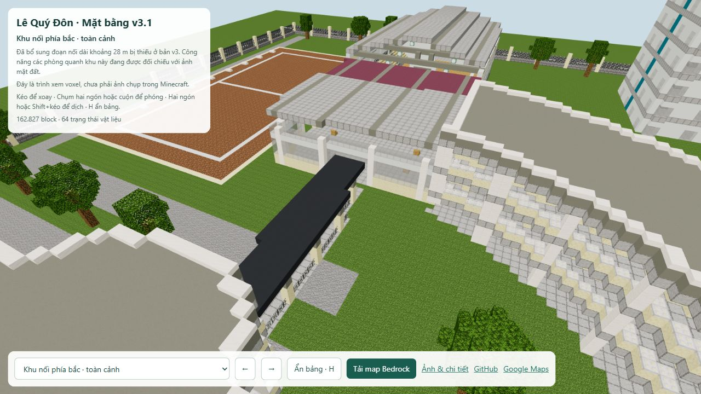
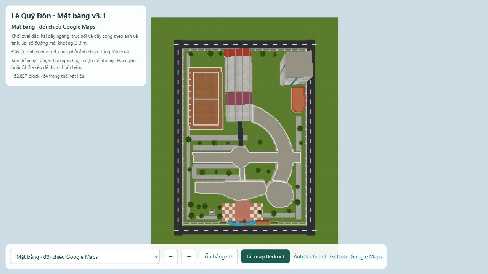

# Lê Quý Đôn Đà Nẵng · Minecraft · Mặt bằng v3.1

**[Xem3D](https://ben11304.github.io/lqd-danang-minecraft/preview/detail.html?view=overview&v=31)** · **[Xem từ trên xuống](https://ben11304.github.io/lqd-danang-minecraft/preview/detail.html?view=top&v=31)** · **[Tải Bedrock cho điện thoại/iPad](https://ben11304.github.io/lqd-danang-minecraft/exports/LQD_DaNang_Layout_Bedrock_v3.mcworld)**

**Cập nhật v3.1:** thêm dải mái nối phía nam khu nhà thi đấu dài khoảng 28 m, theo đa giác truy trên Google Maps. Chiều cao, nhịp cột và lan can là ước dựng. **Vị trí chính xác của căn tin và sảnh C vẫn chưa được xác minh; bản này chưa hoàn tất hai khu đó.** [Nhật ký bằng chứng](references/canteen_lobby_followup.json).

V3 dựng lại bố cục theo [Google Maps tại đúng trường,01 Vũ Văn Dũng](https://www.google.com/maps?cid=681546677781845227). Mái oval phía nam là khối đặc khoảng31×30m; hai dãy ngang tách biệt, nối bằng trục nhỏ khoảng6m; dải cong phía đông sâu khoảng16–18m. Sân thể thao, năm phần mái nối phía bắc, tháp đông bắc và nhà phụ được đặt lại theo các đa giác truy trên ảnh vệ tinh. Không giữ hình khối nửa vòng rỗng của v1/v2.

## Mức độ xác nhận

- **Mặt bằng:** trace thủ công từ ảnh vệ tinh Google Maps truy cập26/10/2026, đăng ký theo giao đường và các phép đo browser. Sai số ước khoảng2–3m; mái nhô, bóng cây và độ lệch mái cao tầng có thể tạo sai số lớn hơn. Năm ghi công2026 không phải ngày chụp vệ tinh.
- **Chiều cao, cột, cầu thang và chức năng phòng:** còn là diễn giải, không phải hồ sơ đo đạc. Tên sảnh A/B/C chưa được gán tùy tiện. Thư viện52block kệ/12ghế đọc, phòng máy16trạm,21phòng học mẫu và khu gym là nội thất đề xuất.
- **Tượng:** bản block giản lược từ [ảnh2012](https://nguoikemon.blogspot.com/2012/05/68-truong-toi-tu-mot-goc-nhin.html), phía tây do người dùng xác nhận: bên phải khi đứng trong trường nhìn ra đường. Khoảng cách/kích thước còn ước lượng.

## Xem và chơi

Web: kéo để xoay, cuộn/chụm để phóng, Shift+kéo/hai ngón để dịch. Chọn sảnh/phòng ở danh sách dưới màn hình. Điện thoại/iPad: tải `.mcworld`, mở bằng Minecraft Bedrock để nhập. Export target Bedrock1.21.0. Có Java1.20.4 và schematic phụ trong `exports/`.

Ảnh web là trình xem voxel, chưa phải ảnh trong Minecraft. Đã đọc lại toàn bộ162.827 block và288 chunk của world; kiểm tra đường đi tới11 điểm công cộng,1385 điểm trên tuyến. **Chưa thử mở trực tiếp trong game.**

## Nguồn và dựng lại

`references/georeference.json` và `references/*_trace.json` lưu mốc cùng đa giác đã truy trước khi dựng. `qa/layout_plan.svg` là mặt bằng mái của model; ảnh Google được giữ ở workspace tham chiếu riêng, không đưa vào repo. `references/layout_plan_review.json` là lượt kiểm tra bố cục độc lập.

Chạy `python -m http.server 8769 --bind 127.0.0.1` tại repo để xem cục bộ. Để dựng lại: tạo 4 module `parts/layout_*.json`, chạy `assemble_layout.py`, `validate_layout.py`, `make_detailed_preview.py`, `configure_layout_viewer.py`, rồi các exporter. Gate và tượng có nguồn riêng; **không áp patch nội thất cũ ở tọa độ v2 lên v3**. Các file `parts/detail_*` và các export v2 được giữ làm lịch sử, không phải đầu vào lớp nhà v3.

Runtime Python và client Minecraft cần chuẩn bị riêng; `get_assets.py` tải asset từ nguồn chính thức. Repo không kèm client jar hoặc các thư viện đã cài. Exporter Bedrock dùng Amulet Core1.9.50 và amulet-leveldb1.0.7 cho CPython3.12 Windows; runtime đặt trong `.bedrock_deps`. Asset model/texture vanilla1.20.4 thuộc Mojang/Microsoft; Three.js0.160.1 theo MIT kèm trong `vendor/`. Dự án không phải sản phẩm chính thức của Minecraft hoặc nhà trường.
