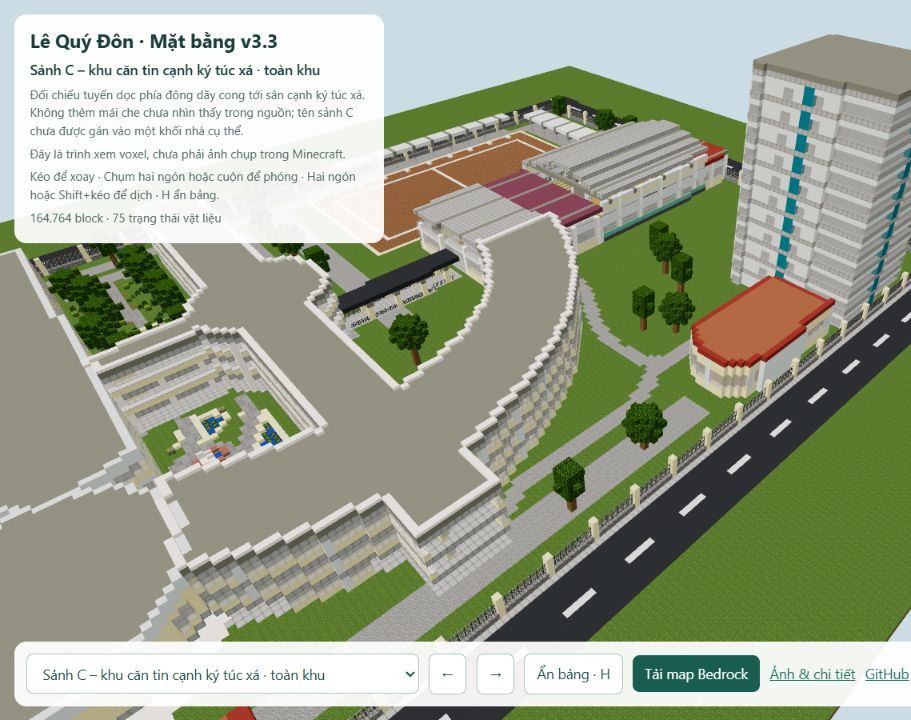
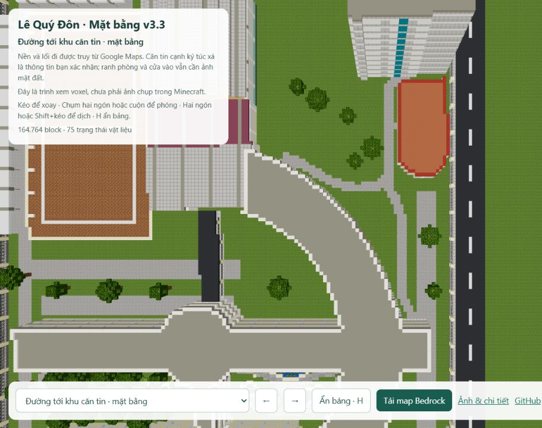

# Lê Quý Đôn Đà Nẵng · Minecraft · v3.3

**[Xem đường tới căn tin cạnh ký túc xá](https://ben11304.github.io/lqd-danang-minecraft/preview/detail.html?view=canteen_route_context&v=33)** · **[Mặt bằng](https://ben11304.github.io/lqd-danang-minecraft/preview/detail.html?view=top&v=33)** · **[Tải Bedrock cho điện thoại/iPad](https://ben11304.github.io/lqd-danang-minecraft/exports/LQD_DaNang_Layout_Bedrock_v3.mcworld?v=de0d6841d81d)**

V3.3 bổ sung nền và đường tiếp cận khu căn tin **cạnh ký túc xá**, theo hướng người dùng xác nhận. Nhánh qua sân phía bắc và tuyến phía đông dãy cong nối lên khoảng sân quanh nhà thấp cạnh tháp; dấu nền được đối chiếu ảnh vệ tinh Google Maps phóng lớn. Phần bị tán cây che được nối giản lược để đi lại trong Minecraft.

Đây là khu đông bắc, khác đoạn mái nối về nhà thi đấu đã mở trước đó. Chưa đủ ảnh mặt đất để chốt chính xác cửa căn tin, ranh phòng và điểm bắt đầu mang tên sảnh C; không dựng thêm mái che từ suy đoán. Một lối mở tầng trệt trong model giúp nối nhánh phía bắc vào hành lang; vị trí cửa này là đề xuất Minecraft, chưa xác nhận bằng ảnh thực tế. Hai vườn trong và các mái phụ của v3.2 được giữ lại. Công năng bãi xe vẫn chưa được xác minh.

## Bằng chứng và giới hạn

Mái nhà và ranh sân truy thủ công từ [Google Maps tại trường, 01 Vũ Văn Dũng](https://www.google.com/maps?cid=681546677781845227), truy cập 26/10/2026, sai số dự kiến 2–3 m. Năm ghi công không phải ngày chụp vệ tinh. Vườn được đối chiếu với [ảnh công khai mang tên sảnh B](https://drive.google.com/file/d/19ASqF0LWPNKoxvaHOJ5ktPoeFQvqbRJ4/view), [ảnh sân trường năm 2008](https://commons.wikimedia.org/wiki/File:Le_Quy_Don_High_School_Campus,_Da_Nang,_Vietnam.jpg) và [kỷ yếu 40 năm](https://drive.google.com/file/d/1TXEm1fgCggApbRagWQ6FrjlikIiKA2iY/view). Chi tiết lịch sử không được xem là xác nhận hiện trạng hôm nay.

[Nhật ký v3.3](references/ne_circulation_revision.json), [nhật ký vườn v3.2](references/landscape_revision.json) và các file `references/*_trace.json` phân biệt dấu vết nhìn thấy với phần ước dựng. Ảnh nguồn Google, ảnh gốc điện thoại và PDF giữ trong workspace tham chiếu riêng; repo chỉ đăng dữ liệu hình học và ảnh model. Báo cáo căn tin/sảnh C là lịch sử v3.1 với mã nguồn của bản đó.

Chiều cao, cột, cầu thang, số tầng và nội thất chưa được khảo sát. Thư viện, phòng máy, lớp học và gym là phương án trải nghiệm Minecraft. Tượng Lê Quý Đôn ở phía tây cổng, bên phải khi đứng trong trường nhìn ra đường, theo người dùng xác nhận; khoảng cách và hình tượng còn giản lược.

## Xem và chơi

[Tuyến tới khu căn tin cạnh ký túc xá](https://ben11304.github.io/lqd-danang-minecraft/preview/detail.html?view=canteen_route&v=33), [sân tiếp cận](https://ben11304.github.io/lqd-danang-minecraft/preview/detail.html?view=canteen_approach&v=33), [toàn khu](https://ben11304.github.io/lqd-danang-minecraft/preview/detail.html?view=canteen_route_context&v=33), [mặt bằng](https://ben11304.github.io/lqd-danang-minecraft/preview/detail.html?view=canteen_route_top&v=33). [Kiểm tra đường đi trong model](qa/ne_circulation_audit.json). Các góc `connector_*` chỉ xem đoạn nối về nhà thi đấu, không phải tuyến căn tin cạnh ký túc xá người dùng đang yêu cầu.

Web: kéo để xoay, cuộn/chụm để phóng, Shift+kéo/hai ngón để dịch. Chọn góc nhìn ở danh sách dưới màn hình. Điện thoại/iPad: tải `.mcworld`, mở bằng Minecraft Bedrock để nhập. Target Bedrock 1.21.0; có Java 1.20.4 và schematic trong `exports/`.

Ảnh web là trình xem voxel. Đã đọc lại 164.764 block trong 288 chunk; 0 block sai so với nguồn. Đường đi từ cổng tới 21 điểm thông suốt, kiểm tra 2988 điểm trên tuyến. Chưa mở thử trực tiếp trong Minecraft.

## Dựng lại

Chạy `python -m http.server 8769 --bind 127.0.0.1` tại repo để xem. Tạo các module `parts/layout_*.json`, chạy `assemble_layout.py`, `validate_layout.py`, `make_detailed_preview.py`, `configure_layout_viewer.py`, rồi hai exporter. Gate và tượng có nguồn riêng. Các file `parts/detail_*` và export v2 được giữ làm lịch sử; không áp patch nội thất tọa độ v2 lên v3.

Runtime và asset Minecraft cần chuẩn bị riêng. `get_assets.py` lấy asset chính thức; repo không kèm client jar hoặc thư viện đã cài. Bedrock exporter dùng Amulet Core 1.9.50, amulet-leveldb 1.0.7, CPython 3.12 Windows trong `.bedrock_deps`. Asset vanilla 1.20.4 thuộc Mojang/Microsoft; Three.js 0.160.1 theo MIT. Dự án không phải sản phẩm chính thức của Minecraft hoặc nhà trường.
