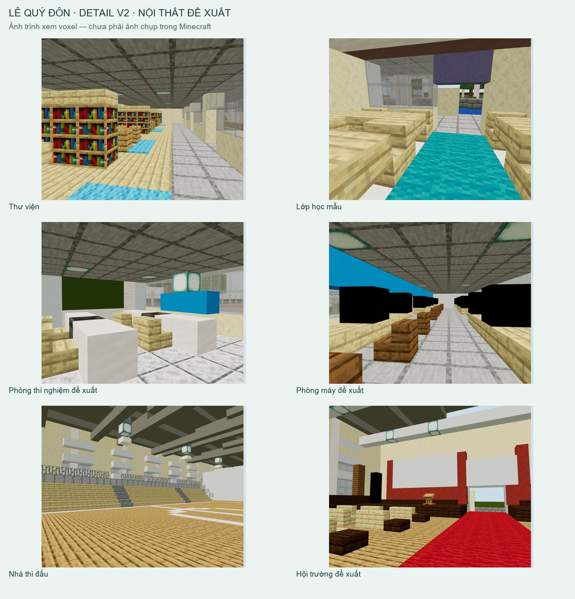

# Lê Quý Đôn Đà Nẵng · Minecraft 3D

Bản tái tạo Minecraft trường THPT chuyên Lê Quý Đôn, Đà Nẵng. Giữ bố cục khảo sát v1 và bổ sung nội thất đề xuất ở v2.

**[Mở mô hình 3D trên web](https://ben11304.github.io/lqd-danang-minecraft/)** · **[Tải map cho điện thoại/iPad](https://ben11304.github.io/lqd-danang-minecraft/exports/LQD_DaNang_Detail_Bedrock_v2.mcworld)**



## Xem và chơi

- Trên web: kéo để xoay, cuộn/chụm hai ngón để phóng, Shift+kéo/hai ngón để dịch tâm. Chọn phòng trong danh sách dưới màn hình.
- Điện thoại/iPad: tải `.mcworld` trong `exports/`, mở bằng Minecraft Bedrock để nhập world. Bản ghi được xuất theo định dạng Bedrock 1.21.0.
- Java phụ tham chiếu: giải nén world Java 1.20.4 trong `exports/` vào thư mục `saves` của profile phù hợp.

## Chi tiết v2

Thư viện với 43 block kệ sách và 12 chỗ đọc; 30 lớp học mẫu; phòng máy 16 trạm; phòng thí nghiệm; khán đài và hội trường. Có 124.250 block, giữ nguyên mái/cổng và không thêm khối nhà ngoài bố cục v1.

Nội thất và chức năng phòng là phương án đề xuất, chưa phải bản sao đo đạc của trường thực. Ảnh web là trình xem voxel từ cùng dữ liệu world, chưa phải ảnh chụp Minecraft. Các file đã được kiểm tra đọc lại toàn bộ block và 288 chunk; **chưa thử nhập/chạy trực tiếp trong game**.

## Tượng và các sảnh

Đã bổ sung tượng Lê Quý Đôn màu trắng trên bệ đá sẫm ở phía tây sân: bên phải cổng khi đứng trong trường nhìn ra đường, theo xác nhận của người dùng. Hình dáng được giản lược bằng block từ [ảnh tư liệu năm 2012](https://nguoikemon.blogspot.com/2012/05/68-truong-toi-tu-mot-goc-nhin.html); khoảng cách đến cổng, kích thước và chi tiết điêu khắc chưa được đo. Chọn góc **Tượng Lê Quý Đôn** hoặc **Tượng và cổng** trên web.

**Các sảnh chưa hoàn thiện.** Đối chiếu lại ảnh cho thấy khối cong phía nam và các tầng trệt không thể áp dụng đồng loạt mô-đun lớp học/hành lang hẹp hiện tại. Cần thêm ảnh định vị để dựng lại hình khối chính xác. Việc thêm chi tiết nội thất không xác nhận độ chính xác của mặt bằng này.

## Chạy tại máy

```sh
python -m http.server 8767 --bind 127.0.0.1
```

Mở `http://127.0.0.1:8767/`. Website là HTML/JavaScript tĩnh, không cần tài khoản hay máy chủ backend. Mô hình tải qua gzip khoảng vài MB, có file thô dự phòng.

## Dữ liệu và dựng lại

- `campus.json`: dữ liệu block toàn trường; `parts/detail_*.py`: các patch nội thất.
- `qa/baseline_campus.json`: mốc v1; `assemble_details.py` ghép các patch.
- `make_detailed_preview.py`: model/UV vanilla, atlas có viền đệm, kính trong suốt.
- `export_world.py`: Java/schematic; `export_bedrock.py`: Bedrock LevelDB qua Amulet.
- `qa/assembly.json`, `exports/bedrock_validation.json`, `exports/qa/export_validation.json`: kết quả kiểm tra và hash nguồn.

Các thư viện Python dựng lại cần cài riêng. `get_assets.py` lấy asset từ nguồn chính thức; Minecraft client và runtime đã cài không được đưa vào repo. Exporter Bedrock dùng Amulet Core 1.9.50 và amulet-leveldb 1.0.7 cho CPython 3.12 trên Windows; chạy trong môi trường `.bedrock_deps` tương ứng.

## Nguồn và ghi công

Hình khối được diễn giải từ ảnh/vệ tinh công khai; không phải bản đồ khảo sát của nhà trường. Các dấu hiệu kiến trúc được đối chiếu từ ảnh Google Maps, báo Nhân Dân, báo Đà Nẵng và Đại học Đà Nẵng. Repo chỉ kèm ảnh chụp mô hình do dự án tạo, không kèm kho ảnh tham chiếu.

Model/texture vanilla được lấy từ Minecraft Java 1.20.4; quyền đối với tài sản Minecraft thuộc Mojang/Microsoft. Dự án không phải sản phẩm chính thức của Minecraft hoặc nhà trường. Three.js 0.160.1 có giấy phép MIT kèm tại `vendor/THREE_LICENSE.txt`.
