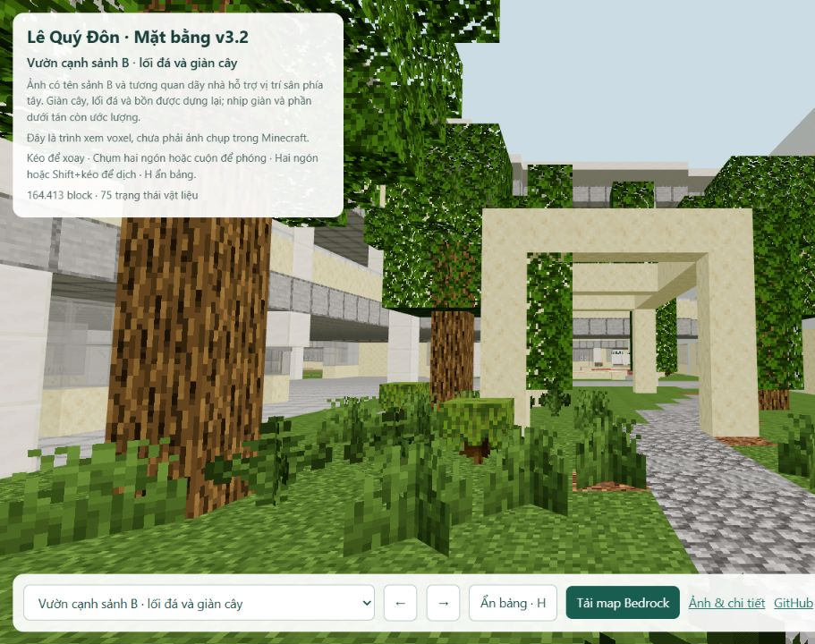
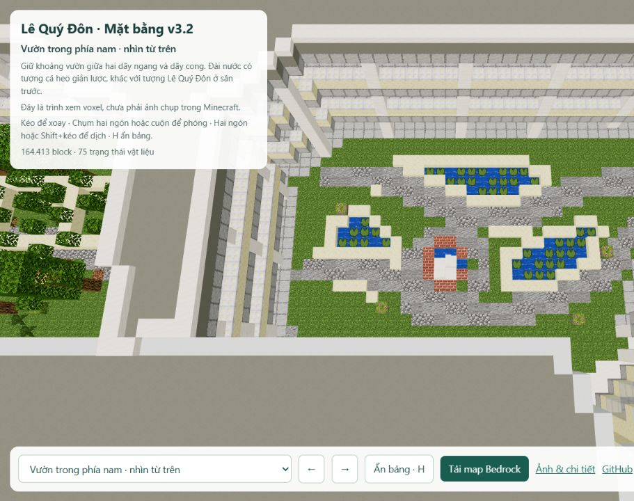

# Lê Quý Đôn Đà Nẵng · Minecraft · v3.2

**[Xem vườn cạnh sảnh B](https://ben11304.github.io/lqd-danang-minecraft/preview/detail.html?view=garden_b&v=32)** · **[Mặt bằng](https://ben11304.github.io/lqd-danang-minecraft/preview/detail.html?view=top&v=32)** · **[Tải Bedrock cho điện thoại/iPad](https://ben11304.github.io/lqd-danang-minecraft/exports/LQD_DaNang_Layout_Bedrock_v3.mcworld?v=783a05b9d5d3)**

V3.2 thay cây mẫu ở hai vườn trong bằng bố cục tham chiếu: sân phía tây giữa hai dãy ngang có đường đá, tán cây và giàn dây leo; vườn trong phía nam có đài tròn, bồn cong và hồ súng. Ảnh có tên sảnh B hỗ trợ vị trí sân phía tây; tên sảnh A chưa được xác minh cho vườn phía nam. Tán cây che khuất một phần nên đường bồn, nhịp giàn và cây vẫn là ước dựng.

Bổ sung mái thấp dài phía đông khối oval và hai mái ở mép bắc/tây sân phía tây bắc theo dấu mái vệ tinh. **Chưa đủ bằng chứng xác nhận đây là bãi giữ xe, cũng chưa chốt ranh toàn bộ bãi xe.** Không thêm xe, vạch đỗ hoặc cổng phụ từ suy đoán. Căn tin và sảnh C vẫn chưa hoàn tất việc xác định vị trí.

## Bằng chứng và giới hạn

Mái nhà và ranh sân truy thủ công từ [Google Maps tại trường, 01 Vũ Văn Dũng](https://www.google.com/maps?cid=681546677781845227), truy cập 26/10/2026, sai số dự kiến 2–3 m. Năm ghi công không phải ngày chụp vệ tinh. Vườn được đối chiếu với [ảnh công khai mang tên sảnh B](https://drive.google.com/file/d/19ASqF0LWPNKoxvaHOJ5ktPoeFQvqbRJ4/view), [ảnh sân trường năm 2008](https://commons.wikimedia.org/wiki/File:Le_Quy_Don_High_School_Campus,_Da_Nang,_Vietnam.jpg) và [kỷ yếu 40 năm](https://drive.google.com/file/d/1TXEm1fgCggApbRagWQ6FrjlikIiKA2iY/view). Chi tiết lịch sử không được xem là xác nhận hiện trạng hôm nay.

[Nhật ký v3.2](references/landscape_revision.json) và các file `references/*_trace.json` phân biệt dấu vết nhìn thấy với phần ước dựng. Ảnh nguồn Google, ảnh gốc điện thoại và PDF giữ trong workspace tham chiếu riêng; repo chỉ đăng dữ liệu hình học và ảnh model. Báo cáo căn tin/sảnh C là lịch sử v3.1 với mã nguồn của bản đó.

Chiều cao, cột, cầu thang, số tầng và nội thất chưa được khảo sát. Thư viện, phòng máy, lớp học và gym là phương án trải nghiệm Minecraft. Tượng Lê Quý Đôn ở phía tây cổng, bên phải khi đứng trong trường nhìn ra đường, theo người dùng xác nhận; khoảng cách và hình tượng còn giản lược.

## Xem và chơi

Web: kéo để xoay, cuộn/chụm để phóng, Shift+kéo/hai ngón để dịch. Chọn góc nhìn ở danh sách dưới màn hình. Điện thoại/iPad: tải `.mcworld`, mở bằng Minecraft Bedrock để nhập. Target Bedrock 1.21.0; có Java 1.20.4 và schematic trong `exports/`.

Ảnh web là trình xem voxel. Đã đọc lại 164.413 block trong 288 chunk; 0 block sai so với nguồn. Đường đi từ cổng tới 18 điểm thông suốt, kiểm tra 2269 điểm trên tuyến. Chưa mở thử trực tiếp trong Minecraft.

## Dựng lại

Chạy `python -m http.server 8769 --bind 127.0.0.1` tại repo để xem. Tạo các module `parts/layout_*.json`, chạy `assemble_layout.py`, `validate_layout.py`, `make_detailed_preview.py`, `configure_layout_viewer.py`, rồi hai exporter. Gate và tượng có nguồn riêng. Các file `parts/detail_*` và export v2 được giữ làm lịch sử; không áp patch nội thất tọa độ v2 lên v3.

Runtime và asset Minecraft cần chuẩn bị riêng. `get_assets.py` lấy asset chính thức; repo không kèm client jar hoặc thư viện đã cài. Bedrock exporter dùng Amulet Core 1.9.50, amulet-leveldb 1.0.7, CPython 3.12 Windows trong `.bedrock_deps`. Asset vanilla 1.20.4 thuộc Mojang/Microsoft; Three.js 0.160.1 theo MIT. Dự án không phải sản phẩm chính thức của Minecraft hoặc nhà trường.
